

  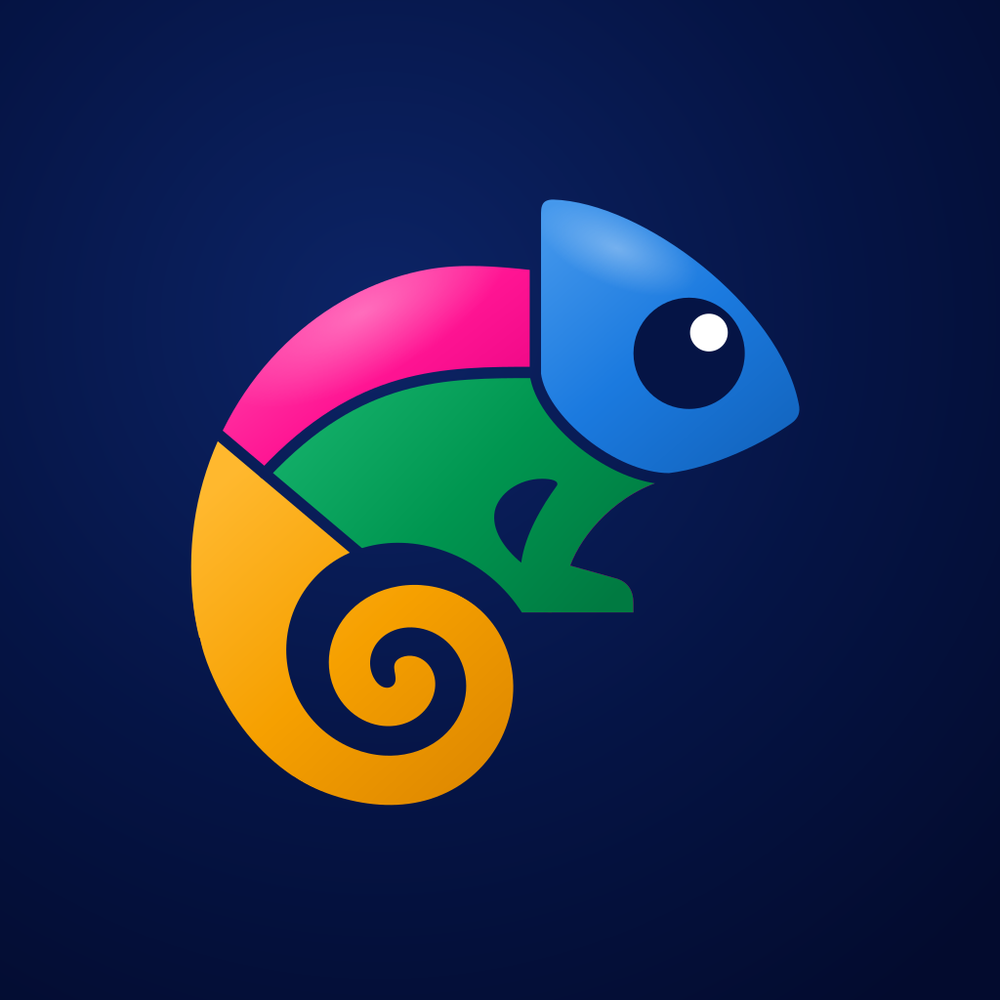

<h1 align="center">ChamFlick DE</h1>

  <b>Gender at a glance. Meaning at a tap.</b> 
  Every German noun in its colour, in books, scanned books and films. 
  Coming soon for Android.

  <a href="https://ali-padash.github.io/chamflick-showcase/">
    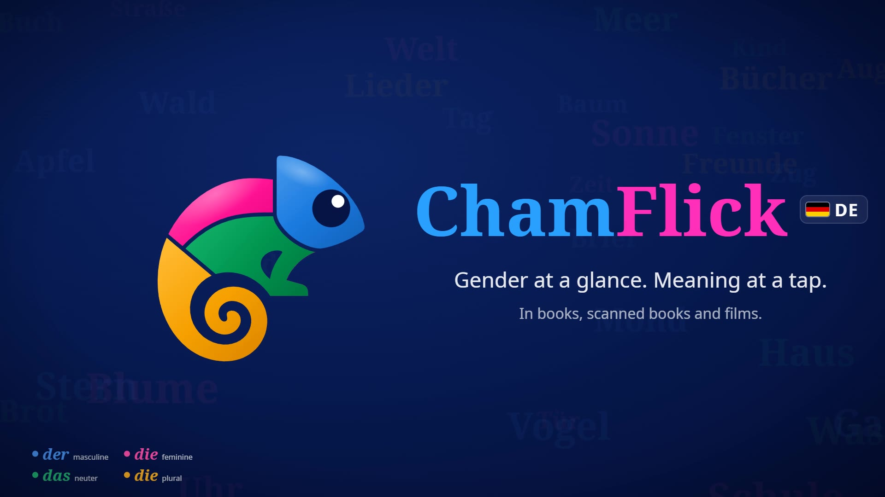
  </a> 
  <a href="https://ali-padash.github.io/chamflick-showcase/"><b>Watch the two-minute preview, and try a page yourself</b></a>

## What it does

ChamFlick DE colours every German noun by its gender while you read, so the
gender is learned with the word instead of looked up afterwards.

| | | |
|---|---|---|
| **der** | masculine | blue |
| **die** | feminine | pink |
| **das** | neuter | green |
| **die** | plural | orange |

A noun the app is not sure of gets no colour, only a dashed underline. It does
not guess.

## Read

| | |
|---|---|
| 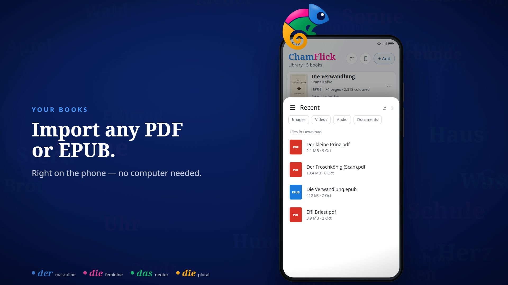 | 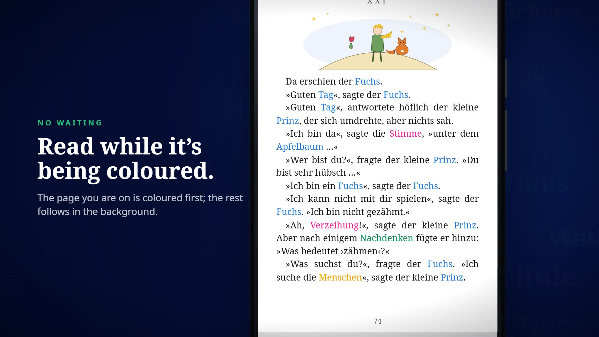 |
| **Import** any PDF or EPUB, on the phone itself. | **Read at once.** Your page is coloured first. |
| 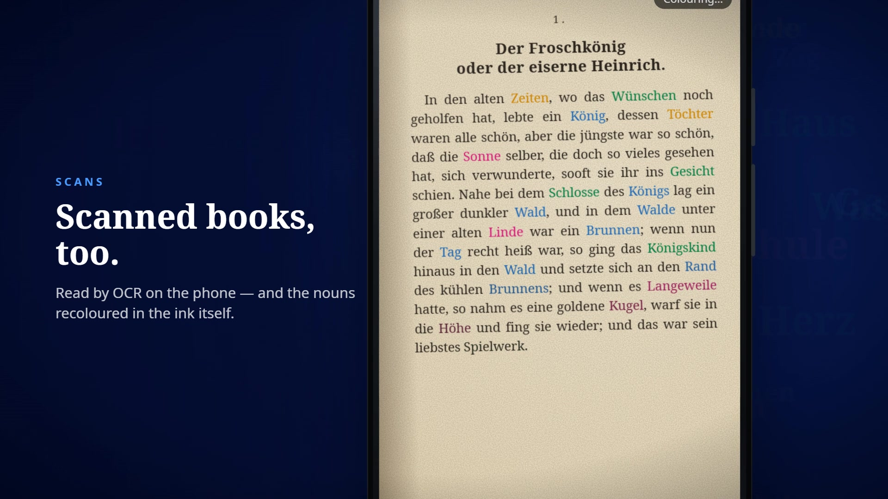 | 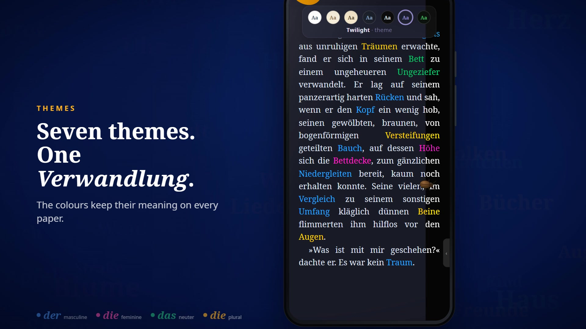 |
| **Scanned books** are read by OCR and recoloured in the ink. | **Seven themes.** The colours keep their meaning. |
| 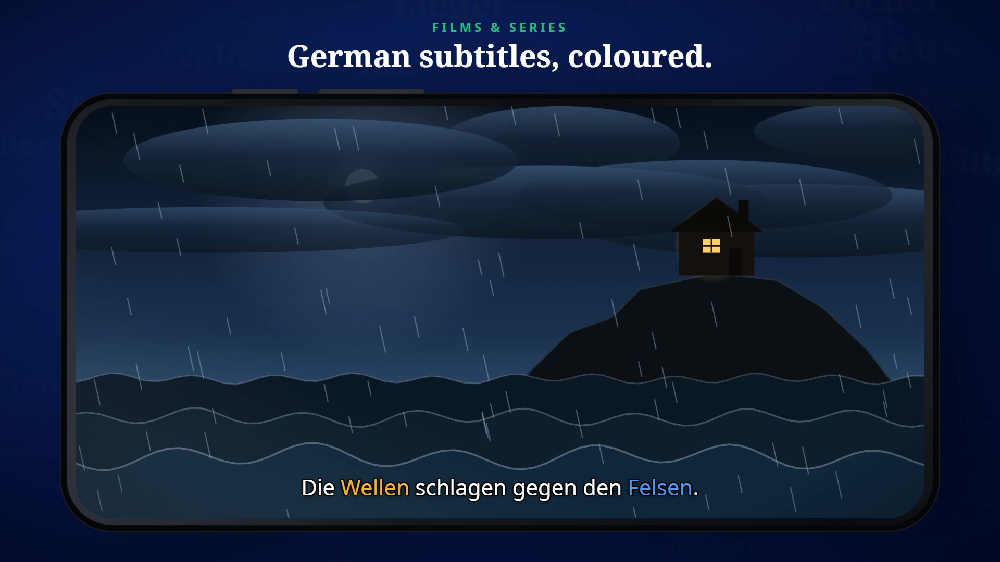 | 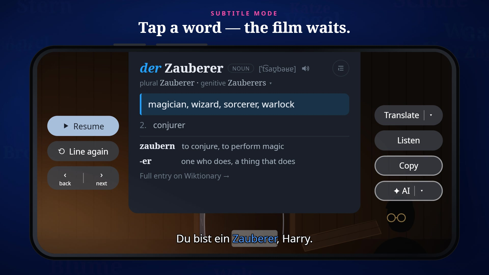 |
| **Films.** German subtitles, coloured live. | **Tap a subtitle word** and the film waits. |

## Understand

| | |
|---|---|
| 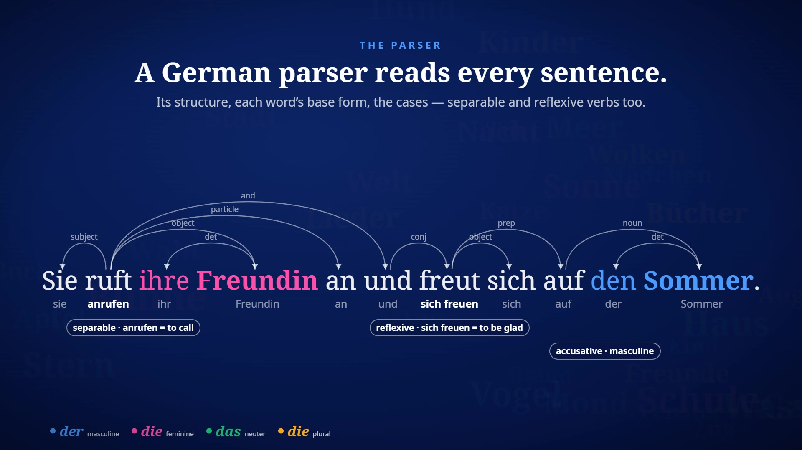 | 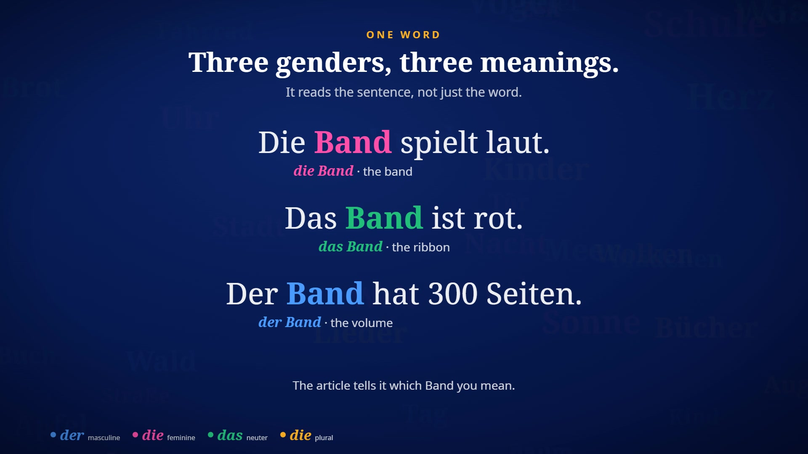 |
| **A German parser** reads every sentence: *ruft … an* becomes *anrufen*. | **One word, three genders:** the band, the ribbon, the volume. |
| 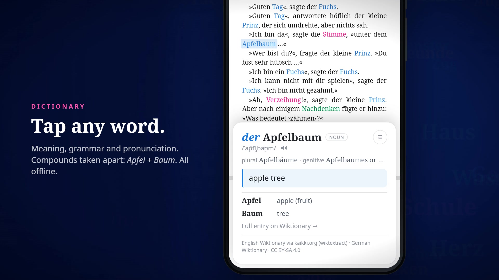 | 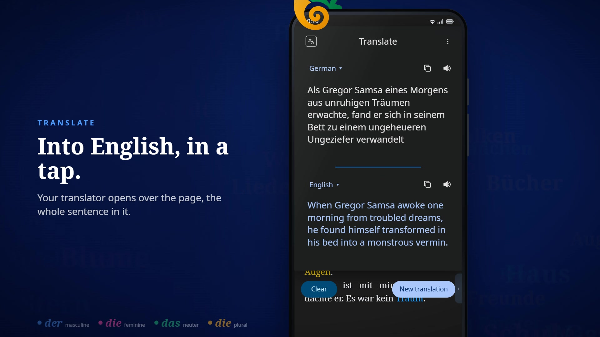 |
| **Tap any word.** Meaning, grammar, pronunciation; compounds taken apart. | **Select a sentence** to translate it, hear it, or ask an assistant. |

## On your phone, and only there

- **No account.** Your books stay on your phone.
- **No internet needed.** The colouring, the OCR and the dictionary work offline.
- **No guessing.** Rules, a dictionary and a parser decide each colour.

## About this repository

This is the showcase only. The app is still in development and its source
code is not public. The pictures are frames from the preview video and its
earlier cuts, which are drawn from the app's own colours and dictionary
answers. On the page itself there is a sample to tap: guess three genders,
switch a page's colours on, open a word's card.

Texts shown: Kafka, *Die Verwandlung* (1915) and the Brothers Grimm, *Der
Froschkönig* (1857), both in the public domain; the lines of *Der kleine
Prinz* are our own translation into German, not a published one. Dictionary
entries come from Wiktionary, CC BY-SA.

The preview's music was written for it. Piano: Salamander Grand Piano by
Alexander Holm, CC BY 3.0. Harp, marimba, glockenspiel and bass: VSCO 2
Community Edition, CC0.

© 2026 Ali Padash Sotoodeh. All rights reserved.
